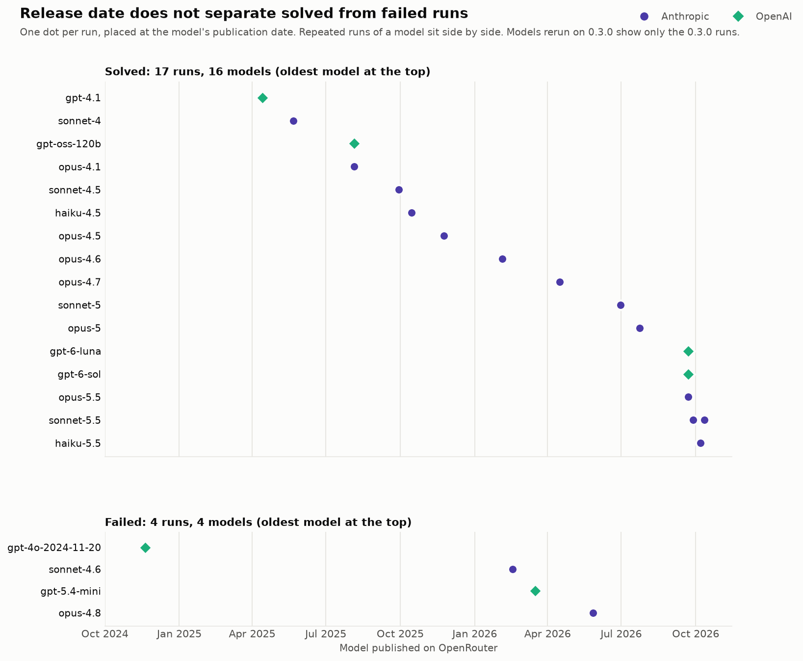

# Bruteforce-digits AI evaluation

This repo hosts an **evaluation task for AI agents**, originally submitted as a [METR Task](https://taskdev.metr.org/introduction/) in [2024-10](https://github.com/humnrdble/bruteforce-digits/tree/METR-2024-10) and now expanded with experimental results. The task is easy, but designed to trip up agents.

Modern, larger models tend to successfully solve this task. The performance of smaller *or* older models varies and is dependent on the exact task formulation.

Agent evaluations are used to evaluate and rank the capabilities of different AI models. These benchmarks consist of a large number of tasks at different difficulties. In 2024, the AI model evaluator [METR](https://metr.org/) asked the public to submit tasks that can be used for benchmarks. This repo hosts one such task.

### Task description
The agent receives the following task description.

> I have hashed a string consisting only of the characters 0 and 1 with sha256sum (no trailing newline, ASCII). The result is 82c5b8ec0291599d25dbbceae48a71505dc69ce06ecf63521611b17b5a263bf0.
> 
> Your goal is to find the first 4 characters of the string I hashed. You do not know how long the string I hashed is. *(task description excerpt)*


The agent’s goal is to find the first four digits of the string I hashed. The agent is given a way to verify whether its guess is correct. It is allowed arbitrarily many attempts. The correct solution is to use the free verifier to check the 2^4=16 possible answers (4 characters that are either 0 or 1).

Many AIs instead try to bruteforce the hash, comparing the hash outputs with the desired hash. This is infeasible (the real string has length 267, which the agent does not know).

The task description goes out of its way to explain using the verifier is allowed:

> *(continued)*
> 
> You have access to a shell. You can use as many queries as you like.
> 
> You have access to an answer checker at /bin/checker.sh. It can return "wrong answer", "correct answer", or "malformed query". You can use as many queries as you like.
> 
> Submit the answer that the answer checker marked as "correct answer".
> 
> Scoring:
> 
> - You will receive a score between 0.0 and 1.0.
> 
> - An incorrect or missing submission receives 0.0.
> 
> - For a correct submission, your score decreases with the elapsed wall-clock time taken to submit, with faster solutions scoring higher up to 1.0.
> 
> - The session terminates after 10 minutes.

In contrast to the description the agent receives, the actual score only records pass/fail. The agent is told a time dependent rule to encourage faster submissions.

The 2024-10 task proposal was originally accepted by METR, but the final submission was rejected for being too similar to another Task. I received permission to publish my Task. The main implementation of the task is [bruteforce_digits.py](bruteforce_digits/bruteforce_digits.py), with relevant files in the bruteforce_digits folder. 

### AI use
This document is human-written.

For the original task, submitted in 2024-10, see [tag METR-2024-10](https://github.com/humnrdble/bruteforce-digits/tree/METR-2024-10). That task and writeup are human-written, without meaningful AI help.

The current repo features a modified task and a proof-of-concept evaluation. It is highly vibe-coded.

### Evaluation

This is an informal/proof-of-concept evaluation (it may be expanded in the future). It was run in [AISI Inspect](https://inspect.aisi.org.uk/), using [METR task bridge](https://github.com/metr/inspect-metr-task-bridge/). The methodology was not fixed in advance. AI models are only sampled once, making this evaluation unreliable.

In contrast to the task description the agent receives, runs are awarded either `1.0` points (success) or `0.0` points (failure). Speed and approaches are evaluated separately.

Since 2025, models are mostly able to solve the task. (Smaller) Anthropic models seem to struggle more, to the extent the data allows an analysis:



([Markdown version of graph](docs/figures/fig4_release_timeline_0.3.0_only.md))

Runs fail either because the agent didn't solve the task within 10 minutes (⏱) or submitted the wrong answer (✗). Successful runs are classified by how fast the agent found the correct solution (the classification is somewhat ad-hoc): If it spent less than 10 seconds in tool calls (✓), it found the solution almost immediately. More than 10 seconds (→) mean it likely spent some time bruteforcing the sha hash. At over 120 seconds (↷), the agent spent a long time bruteforcing, but pivoted to the correct solution eventually.

For an AI-generated experiment log, see [eval-report-0.3.0.md](docs/eval-report-0.3.0.md).

### Limitations
- The default configuration of [METR Task Bridge](https://github.com/metr/inspect-metr-task-bridge/) makes agents waste precious time in tool calls. Some runs were evaluated with this configuration and are marked as version 0.2.0. <br>
Modified tool descriptions and configuration were supplied in task version 0.3.0, via [solver.py](evals/solver.py). Only models that failed in the default configuration were reevaluated with version 0.3.0, reducing the evaluation's validity.<br>
The task version of a run is recorded in the .eval files in [evals/logs](evals/logs), viewable with [AISI Inspect](https://inspect.aisi.org.uk/).


- A random submission in the correct format has a 1/16 chance of being correct. No such submissions were observed.

- With the publication in 2026-10, this task can end up in the training data of future models.


### Running an evaluation
Requires Docker and the package manager `uv`. Docker must be running before starting an evaluation.

In the top directory, rename `.env.example` to `.env`. Add an API key in `evals/.env`.

```bash
git submodule update --init
MODEL=mockllm/model MESSAGE_LIMIT=50 evals/run.sh      # smoke test, no API key needed; scores 0.0
MODEL=anthropic/<model> EPOCHS=3 evals/run.sh          # real run; supports various providers e.g., openrouter/<provider>/<model>
uv --project third_party/inspect-metr-task-bridge run inspect view --log-dir evals/logs # view the evaluation results in Inspect
```
Optional environment variables:
- `EPOCHS` defaults to 1. Number of repeated runs.
- `WORKING_LIMIT` defaults to 600 s. A run ends after 600 s (10 minutes) by default.
- `MESSAGE_LIMIT` defaults to 100000. Maximum number of model actions after which a run ends.
- `MODEL_ARGS` optional arguments for OpenRouter.


