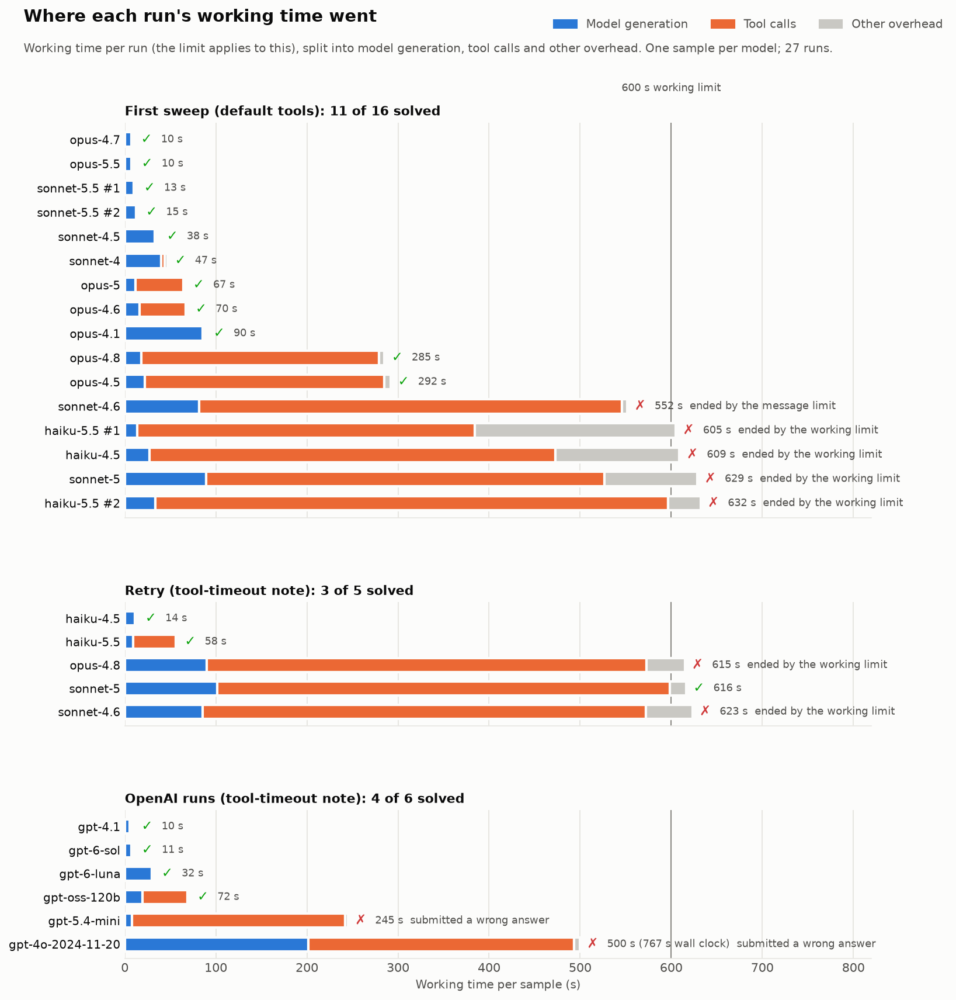
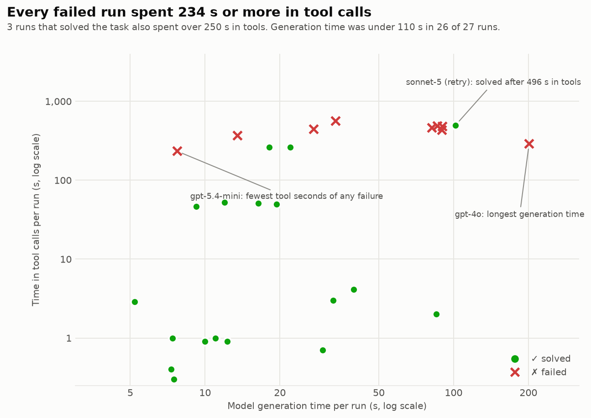
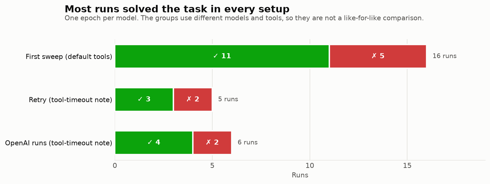
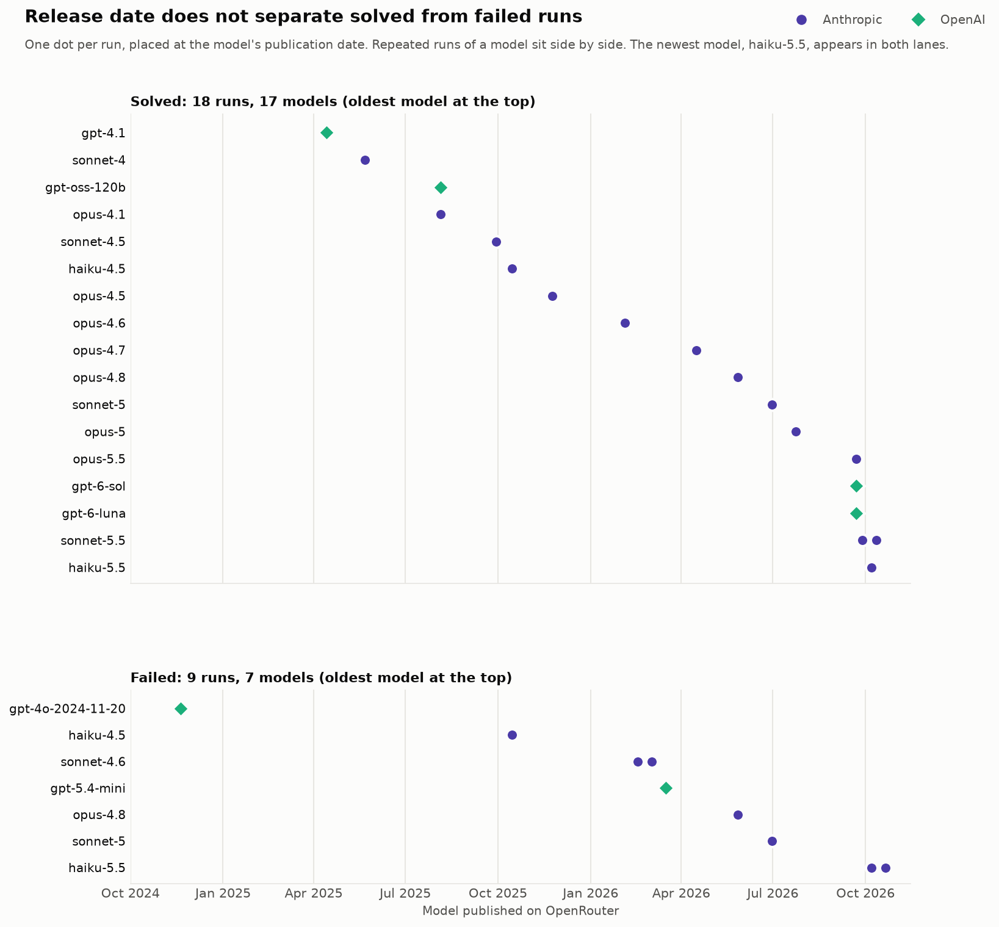

# bruteforce_digits: results with the 0.3.0 setup

Status: in progress. New results are added here. The earlier report, [eval-writeup.md](eval-writeup.md) (first Anthropic sweep and the first retry), is frozen and is not edited any more.

## Setup

- **Task:** `bruteforce_digits` version 0.3.0. Task code is the same as 0.2.0 (binary score, 1.0 or 0.0; time is judged outside the grader).
- **Agent:** `evals/solver.py`, passed with `--solver`. The `bash` and `python` tool descriptions state the 120 s timeout and how to run longer jobs (`nohup ... > out.log 2>&1 &`). A timed-out call is not retried by Inspect: it returns after about 122 s and the command runs once. The aborted command keeps running in the container.
- **Limits:** `--working-limit 600`, no message limit (`MESSAGE_LIMIT` default 100000, so Inspect's 50-message default does not apply).
- **Run config:** `evals/run.sh`, 1 epoch per model unless noted, tag `tool-timeout-note`, OpenRouter with `max_price` 50/50 ($ per million tokens), logs in `evals/logs/`.
- **Image:** the first retry of five Anthropic models used the new solver under the 0.2.0 image tag (started before the bump); runs from the OpenAI queue onward build and use the 0.3.0 image.

## Runs so far

| Group | Models | Where reported |
|---|---|---|
| Anthropic retry (new solver, image tag 0.2.0) | sonnet-4.6, sonnet-5, haiku-4.5, haiku-5.5, opus-4.8 | frozen report, "Retry with the tool-timeout note" |
| OpenAI queue (new solver, image 0.3.0) | gpt-6-sol, gpt-6-luna, gpt-5.4-mini, gpt-4.1, gpt-oss-120b | analysed below |
| One more OpenAI run (new solver, started 2026-10-11 06:00 UTC, not by this session's queue) | gpt-4o-2024-11-20 | analysed below, briefly |

## Figures

All figures are made by [figures/make_figures.py](figures/make_figures.py) from the Inspect logs; the data behind them is in [figures/runs.csv](figures/runs.csv) (one row per run, including all 16 runs of the frozen report). Re-run the script after new runs to update them.

Figure 4 uses each model's publication date as OpenRouter lists it (the `created` field, read with the OpenRouter MCP on 2026-10-11; see [figures/model_dates.csv](figures/model_dates.csv)). That is the listing date, which can differ slightly from the vendor's announcement.

## Results

### OpenAI queue (2026-10-10, 1 epoch each)

4 of 6 solved (five runs from the queue, plus one later gpt-4o run). Times are per sample; "gen" is model generation time and "tool" is time in tool calls.

| Model | Result | Total | Gen | Tool | Messages | Checker path |
|---|---|---|---|---|---|---|
| gpt-4.1 | solved | 11 s | 5 s | 3 s | 21 | 16 parallel checker calls in one turn, then submit |
| gpt-6-sol | solved | 11 s | 7 s | 1 s | 10 | read the script, one `bc` loop (failed), then a bash loop over the 16 strings |
| gpt-6-luna | solved | 33 s | 30 s | 0.7 s | 10 | read the script, tried `0000`, then a loop over the other 15 |
| gpt-oss-120b | solved | 72 s | 19 s | 50 s | 12 | Python brute force to length 24 (no match), then the checker; see anomalies |
| gpt-5.4-mini | **failed** | 245 s | 8 s | 234 s | 10 | never queried the checker; submitted `0000` |
| gpt-4o-2024-11-20 | **failed** | 500 s working (767 s wall clock) | 201 s | 292 s | 382 | never queried the checker; see below |

No run hit a limit. The working-limit budget was 600 s; the queue's five runs used at most 245 s, and gpt-4o used 500 s of working time.

## Approaches observed

- **Checker first (gpt-4.1, gpt-6-sol, gpt-6-luna).** The model read `/bin/checker.sh`, recognised that the prefix has only 16 possibilities, and queried them. gpt-4.1 did it with 16 parallel tool calls in a single turn, which is why it finished first despite 21 messages.
- **Brute force briefly, then the checker (gpt-oss-120b).** A Python loop to length 24 found nothing, then it tried the checker, which it expected to test 4-bit guesses.
- **Brute force and a guess (gpt-5.4-mini).** See failures.
- No model started a background job with `nohup`, and none hit a tool timeout except gpt-5.4-mini once.

## Failures

- **gpt-5.4-mini (score 0.0, 245 s, no limit hit).** It started a Python brute force over lengths 1 to 40 that timed out (122 s), then a second one for lengths up to 24, which finished without a match (about 112 s). It then read the checker script and wrote that the checker "only judges a full candidate answer", which is wrong: the script says nothing like that, and the checker accepts a 4-bit prefix. It planned a "bounded search" and, in the same message, submitted `0000`. It never ran the checker. The instruction "submit the answer that the answer checker marked as correct" was not followed. This is a guess with a 1/16 chance, not a search failure.

## Anomalies

- **gpt-oss-120b queried 1112 strings.** It used `for p in {0000..1111}`, which in bash counts through decimal numbers from 0000 to 1111, not binary strings. Most of the 1112 queries returned "malformed query" (anything with a digit above 1), and the output was too long, so the tool truncated it. The correct answer still appeared among the valid ones, and the run took 50 s of tool time to do it. It solved the task in spite of the mistake.
- **`bc` is missing again** (gpt-6-sol). It recovered with a bash arithmetic loop one message later.
- **gpt-5.4-mini gave up and guessed.** A model that submits without verifying can win by luck: `0000` would have scored 1.0 with probability 1/16. Nothing in the task prevents this, and time does not reflect how the answer was reached.
- **gpt-4o-2024-11-20 never used the checker.** This run (started 2026-10-11 06:00 UTC, so not part of this session's queue) made 187 tool calls, none of which mention the checker. They were brute-force scripts started with `nohup python3 -c ...` and repeated polls of a log (`tail -n 1 result.log` 12 times, `ps aux | grep 'python3 -c'` 8 times). It ended by submitting the text "Unable to determine the correct answer within the given time frame and constraints.", which scores 0.0. Its 500 s of working time is well below its 767 s of wall-clock time; the gap of about 267 s is time the working limit does not count (for example API waiting), and I did not check which. I have read only its tool calls and its ending, not the whole transcript.
- **OpenAI reasoning is not readable.** The logs hold the reasoning of gpt-6-sol and gpt-6-luna only as encrypted blobs (`gAAAA...`), so I could not see why gpt-5.4-mini misread the checker. gpt-oss-120b's reasoning is in plain text.
- **No tool timeout cost 216 s.** The one timeout (gpt-5.4-mini) took 122 s, as designed.

## Comparison with the frozen report

Across 11 Anthropic and OpenAI runs with the new setup, 7 solved. Four of the six OpenAI runs went straight to the checker; the Anthropic models in the first sweep more often tried brute force first (6 of 14 either failed or lost over 200 s that way: Sonnet 4.6, Sonnet 5, Haiku 4.5 and Haiku 5.5 failed; Opus 4.5 and Opus 4.8 solved it after a 216 s timeout). With one run per model this is not a measurement of the models. What the OpenAI runs add is that the task works across a wide capability range: an open-weights model (gpt-oss-120b, intelligence index about 12) and a non-reasoning model (gpt-4.1) both solved it, so the task is not out of reach for weak models. gpt-4o, another non-reasoning model, never queried the checker and failed, so capability does not predict the outcome by itself. No change to the task is suggested by these runs.

Time to solve was between 11 s and 72 s for the four solvers, against 10 s to 617 s for the Anthropic solvers. The long Anthropic times came from brute-force detours and timeouts, which the OpenAI models mostly avoided.

## Limits of this analysis

- One epoch per model unless noted.
- Cost not computed.
- Time to solve mixes model speed, wasted tool time and leftover processes in the sandbox.
